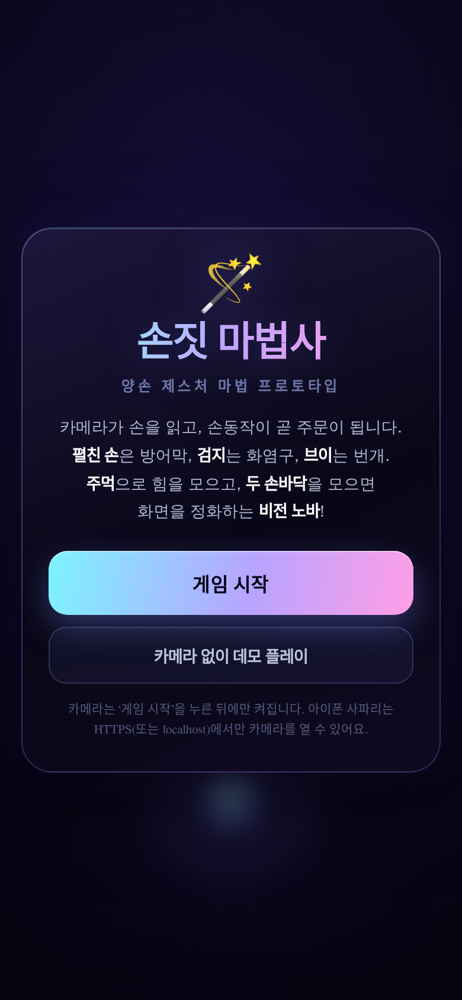

# 🪄 손짓 마법사 — 양손 제스처 마법 프로토타입

카메라로 양손을 읽어, 손동작만으로 주문을 발동하는 미니게임 프로토타입입니다.
단일 HTML 파일(`index.html`)로 동작하며, 서버·빌드 과정이 필요 없습니다.



- **라이브 데모 (HTTPS, 아이폰 카메라 사용 가능):** https://redcrono.github.io/hand-magic-prototype/
- **저장소:** https://github.com/redcrono/hand-magic-prototype

> 아이폰 사파리는 **HTTPS(또는 localhost)** 에서만 카메라를 허용합니다.
> GitHub Pages 주소로 열면 바로 카메라 모드로 플레이할 수 있고, 카메라가 없거나 권한이 거절되면 **데모 모드**(마우스/터치)로 플레이할 수 있습니다.

---

## 손동작

| 손모양 | 이름 | 게임에서의 효과 |
|---|---|---|
| ✋ 손바닥 | 방어막 (Shield) | 손바닥 위치에 비전 방어막이 생겨, 닿는 적 마법구를 부숩니다. |
| ☝️ 검지 | 화염구 (Arcane Bolt) | 손끝에서 가장 가까운 적을 자동 조준해 화염구를 발사합니다. (연사 가능) |
| ✌️ 브이 | 연쇄 번개 (Chain Lightning) | 손끝에서 가까운 적 최대 3명에게 번개가 연쇄로 내리칩니다. |
| ✊ 주먹 | 충전 → 충격파 (Shockwave) | 주먹을 쥐고 있으면 마나가 차오르고, 손을 펴는 순간 충격파가 터집니다. |
| 🙌 양손 합체 | 비전 노바 (Arcane Nova) | 두 손바닥을 가까이 모으면 융합 구체가 차오르고, 완성되면 화면의 적을 모두 정화합니다. (쿨다운 6초) |

**TIP.** 한 손은 ✋ 방어막, 다른 한 손은 ☝️/✌️ 공격에 쓰면 훨씬 오래 버팁니다.
두 손으로 동시에 공격할 수도 있습니다.

## 게임 규칙

- 마법진(화면 아래)으로 적 마법구가 다가옵니다. 마법진에 닿으면 HP가 줄어듭니다.
- 적을 부수면 점수와 콤보가 쌓이고, 콤보에 따라 점수 배율이 **최대 x6**까지 오릅니다.
- 20초마다 웨이브가 올라가 적이 빨라지고 종류가 늘어납니다.
- HP가 0이 되면 게임 오버. 최고 점수는 브라우저에 저장됩니다.

## 실행 방법

### 1) 이미 배포된 주소로 플레이 (권장)

https://redcrono.github.io/hand-magic-prototype/ — HTTPS라서 아이폰 사파리에서도 카메라가 열립니다.

### 2) 내 컴퓨터에서 로컬 실행

```bash
cd projects/hand-magic
python3 -m http.server 8000
```

- 데스크톱: http://localhost:8000 (localhost는 카메라 허용)
- 아이폰: `http://<PC의 LAN IP>:8000` 은 **HTTPS가 아니라 카메라가 차단**됩니다. 이때는 데모 모드로만 플레이하거나, 아래처럼 HTTPS 호스팅을 쓰세요.

### 3) 직접 HTTPS로 호스팅

`index.html` 한 파일만 있으면 됩니다.

- **GitHub Pages:** 저장소에 파일을 올리고 Settings → Pages → Branch `main` / `/ (root)` 저장
- **Netlify Drop / Cloudflare Pages:** 폴더를 그대로 끌어다 놓기
- **Vercel:** 정적 프로젝트로 배포

## 데모(카메라 없이) 모드

- 시작 화면에서 **카메라 없이 데모 플레이**를 누릅니다.
- 화면을 드래그해 손을 움직이고, 아래 버튼(✋ ☝️ ✌️ ✊ 🙌)으로 손동작을 바꿉니다.
- 카메라 권한이 거절되었거나 HTTPS가 아닐 때도 이 모드로 전체 게임 루프를 확인할 수 있습니다.

## 구현 메모

- **손 추적:** MediaPipe Hands(`@mediapipe/hands@0.4.1675469240`)를 jsDelivr CDN에서 로드, `maxNumHands: 2`.
  - 모바일 성능을 위해 `modelComplexity: 0`, 추론은 약 22fps로 스로틀.
  - 손가락 펴짐은 손목 기준 거리 비율로 판정하고, 2프레임 안정화로 떨림을 줄입니다.
- **렌더링:** Canvas 2D. 전면 카메라를 좌우 반전해 배경으로 깔고 어두운 안개·비네트를 덮었습니다.
  - 손 관절 위에 발광 룬·골격, 손바닥에 회전 마법진을 그립니다.
- **효과음:** Web Audio API로 전부 절차 생성(외부 음원 없음). iOS 사파리를 위해 **게임 시작 탭**에서 오디오 컨텍스트를 언락합니다.
- **게임 루프:** 적 마법구 스폰·유도 이동, 방어막 충돌, 유도 화염구, 연쇄 번개, 충격파, 노바, 파티클, 화면 흔들림, 콤보 배율.
- **의존성:** MediaPipe 스크립트 1개(CDN). 그 외 라이브러리·빌드 도구 없음.

## 개인정보

- 카메라 영상은 **기기 안에서만** 처리되며 서버로 전송되지 않습니다.
- MediaPipe 모델 파일만 jsDelivr CDN에서 내려받습니다.
- 카메라는 ‘게임 시작’을 누른 뒤에만 켜지고, ‘처음으로’를 누르면 즉시 정지합니다.

## 알려진 제한

- 프로토타입입니다. 손 인식 정확도는 조명·배경·손 각도에 영향을 받습니다.
- iPhone은 Safari 15 이상 권장. 구형 기기에서는 프레임이 떨어질 수 있습니다.
- 두 손이 화면에 다 들어와야 합체(노바)를 쓰기 편합니다.
- 카메라가 없는 환경(데스크톱 웹캠 미장착)에서는 데모 모드를 사용하세요.

## 파일

```
projects/hand-magic/
  index.html   # 게임 전체 (HTML + CSS + JS 단일 파일)
  README.md    # 이 문서
```

## 크레딧

- 손 추적: [MediaPipe Hands](https://developers.google.com/mediapipe) (Google, Apache-2.0)
- 사운드: Web Audio API 실시간 합성
