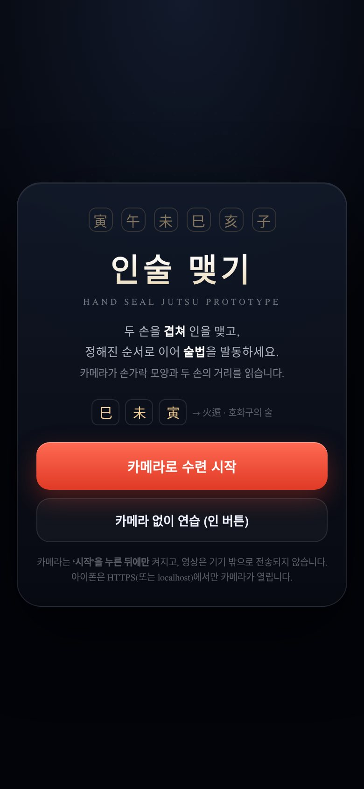
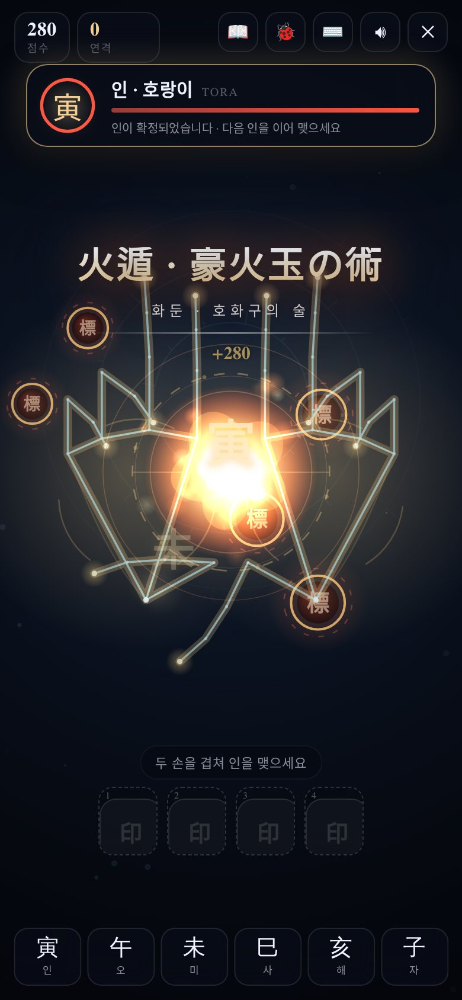

# 🥷 인술 맺기 — 겹쳐 맺는 인(印) 프로토타입

카메라로 **양손을 겹쳐 인(印)을 맺고**, 정해진 순서로 이어 **술법**을 발동하는 나루토 스타일 프로토타입입니다.
한 손 제스처가 아니라 **두 손을 맞대거나 겹치는 6가지 인**을 MediaPipe Hands로 읽습니다.
단일 HTML 파일(`index.html`) 하나로 동작하며, 서버·빌드 과정이 필요 없습니다.



- **라이브 데모 (HTTPS, 아이폰 카메라 사용 가능):** https://redcrono.github.io/hand-magic-prototype/
- **저장소:** https://github.com/redcrono/hand-magic-prototype

> 아이폰 사파리는 **HTTPS(또는 localhost)** 에서만 카메라를 허용합니다.
> GitHub Pages 주소로 열면 바로 카메라로 인을 맺을 수 있고, 카메라가 없거나 권한이 거절되면 **인 버튼 연습 모드**로 모든 술법을 시험할 수 있습니다.



---

## 인 여섯 가지 · 六印

| 인 | 칸지 | 동물 | 손 모양 | 인식 포인트 |
|---|---|---|---|---|
| 인 | 寅 | 호랑이 | 양손 검지·중지를 세워 나란히 맞대기 | 두 손가락을 세운 두 손이 **평행**하게 가까이 |
| 오 | 午 | 말 | 양손 검지 끝을 맞대고 세모(삼각형) 세우기 | 검지 끝이 **맞닿고** 손목은 벌어져 손이 **비스듬** |
| 미 | 未 | 양 | 한 손은 세우고, 다른 손을 가로로 겹쳐 대기 | 한 손은 세로, 다른 손은 **직각**으로 겹침 |
| 사 | 巳 | 뱀 | 양손 손가락을 모아 겹쳐 쥐기 | 두 손이 **주먹**인 채로 가까이 |
| 해 | 亥 | 돼지 | 양손바닥을 겹쳐 마주 대고 손가락 모으기 | 두 손이 **펴진 채** 손바닥을 맞댐 |
| 자 | 子 | 쥐 | 한 손 주먹 위에 다른 손 검지·중지를 세워 겹치기 | **주먹 + 두 손가락**이 겹침 |

인식은 손가락 펴짐(연속값), 두 손의 손바닥 거리, 손끝 거리, 손의 방향(평행/직각)을 함께 봅니다.

## 술법 네 가지 · 術

| 순서 | 술법 | 효과 |
|---|---|---|
| **巳 → 未 → 寅** | 火遁 · 호화구의 술 | 손에 화염을 모아 거대한 화염구를 내지른다 (광범위 폭발 + 화면 흔들림) |
| **午 → 寅 → 巳** | 雷遁 · 치도리 | 손끝에 번개를 모아 모든 표적을 꿰뚫는 섬광 (화면 전체 번쩍임) |
| **寅 → 子 → 亥** | 水遁 · 수룡탄의 술 | 화면을 S자로 가로지르는 물의 용 (경로 위 표적 타격) |
| **未 → 寅** | 多重影分身の術 | 연기와 함께 분신들이 사방으로 튀어나온다 (주변 표적 타격) |

순서가 틀리면 슬롯이 비워지고 다시 맺어야 합니다. 위쪽 **인 배지**에는 지금 인식되는 인과 확신도가 실시간으로 표시됩니다.

## 플레이 방법

### 1) 아이폰에서 (권장)

1. https://redcrono.github.io/hand-magic-prototype/ 를 사파리로 엽니다.
2. **카메라로 수련 시작**을 누르고 카메라 권한을 허용합니다.
3. 두 손을 화면 안에 넣고, 위 표의 손 모양을 **겹쳐서** 0.2초 정도 유지합니다.
4. 인이 확정되면 슬롯에 칸지가 찍히고 북소리가 납니다. 순서를 이으면 술법 발동.
5. 잘 안 잡히면 **🐞 디버그**를 켜서 어떤 인이 몇 %로 잡히는지 보면서 손 각도를 조금씩 바꿔 보세요.

### 2) 카메라 없이

**카메라 없이 연습 (인 버튼)** 을 누르면 화면 아래 여섯 칸지 버튼으로 인을 맺을 수 있습니다.
카메라 권한이 거절되었거나 HTTPS가 아닐 때도 술법 연출을 전부 확인할 수 있습니다.

### 3) 내 컴퓨터에서 실행

```bash
# index.html이 있는 폴더에서
python3 -m http.server 8000
```

- 데스크톱: http://localhost:8000 (localhost는 카메라 허용)
- 아이폰: `http://<PC의 LAN IP>:8000` 은 HTTPS가 아니라 카메라가 차단됩니다. 이때는 인 버튼 모드로 연습하거나 GitHub Pages 주소를 쓰세요.

## 화면 구성

- **위쪽 인 배지** — 지금 인식되는 인(칸지·이름·확신도). 0.2초 유지하면 확정.
- **인술 슬롯 4칸** — 확정된 인이 순서대로 찍힙니다. 술법이 발동하면 비워집니다.
- **📖 술법 도감** — 여섯 인의 손 모양 설명, 네 술법의 순서, 내 인식 기록(횟수·최고 확신도)을 봅니다. 기록은 브라우저에 저장됩니다.
- **🐞 디버그** — 여섯 인의 실시간 확신도 막대, 손가락 펴짐 값, 손바닥 거리·손끝 거리·방향 값을 봅니다. **아이폰에서 어떤 자세가 잘 잡히는지 확인할 때 유용합니다.**
- **⌨️ 인 버튼** — 수동 인 버튼 표시/숨김.
- **연격** — 표적을 부술 때마다 올라가고 4.2초 안에 이어야 유지됩니다. 최고 점수는 브라우저에 저장됩니다.

## 인식 원리 (구현 메모)

- **손 추적:** MediaPipe Hands(`@mediapipe/hands@0.4.1675469240`)를 jsDelivr CDN에서 불러옵니다. `maxNumHands: 2`, 모바일 성능을 위해 `modelComplexity: 0`, 추론은 약 22fps로 스로틀합니다.
- **겹침 처리 (핵심):** 두 손을 겹치면 MediaPipe가 한 손을 잠깐 놓치는 일이 잦습니다. 그래서
  - 손이 사라져도 **0.62초 동안 마지막 관절 위치를 유지**하고(고스트),
  - 그 사이 두 손의 손바닥 거리·손끝 거리·방향으로 인을 계속 판정합니다.
  - 사라진 손은 0.62초가 지나면 완전히 해제되어, 한 손만 든 상태로는 인이 확정되지 않습니다.
- **손가락 펴짐:** 각 손가락의 PIP·DIP 관절 각도와 손목 대비 손끝 거리를 섞어 0~1 연속값으로 계산합니다. 접힘/폄을 딱 잘라 판정하지 않아 겹쳐도 관대합니다.
- **좌표계:** 카메라 영상이 화면에 맞춰 늘어나므로, 각도·거리 계산은 **영상 프레임 비율로 편 좌표**에서 합니다(화면 늘어짐의 영향 없음).
- **인 판정:** 6개 인마다 점수 함수(손가락 패턴 × 두 손 거리 × 방향)를 두고, 지수 평활(빠른 상승·느린 하강) 후 **0.56 이상이 0.19초 유지**되면 확정합니다. 확정된 인은 자세를 풀어야 다시 찍히므로 한 자세가 여러 번 중복 확정되지 않습니다.
- **술법 판정:** 슬롯 꼬리와 술법 순서를 비교해 가장 긴 것부터 맞춥니다(예: 未寅은 분신, 巳未寅은 호화구).
- **효과음:** Web Audio API로 전부 절차 생성(외부 음원 없음). 인 확정 시 북소리+징, 술법별 효과음. iOS 사파리를 위해 시작 버튼 탭에서 오디오를 언락합니다.
- **렌더링:** Canvas 2D. 전면 카메라를 좌우 반전해 배경으로 깔고, 손 관절 위에 발광 골격·손바닥 차크라를 그립니다. 두 손이 가까우면 사이에 인진(印陣) 고리가 생깁니다.
- **의존성:** MediaPipe 스크립트 1개(CDN). 그 외 라이브러리·빌드 도구 없음.

### 자동 테스트용 훅

`window.HM_DEBUG` 로 합성 손 좌표를 넣고 판정을 검사할 수 있습니다.

```js
HM_DEBUG.pause(true);
HM_DEBUG.inject([landmarks21_left, landmarks21_right], [{label:'Left'},{label:'Right'}]);
HM_DEBUG.step(0.05);            // 0.05초 진행
HM_DEBUG.state();               // slots, bestSeal, jutsu 카운트 등
HM_DEBUG.raw();                 // 6개 인의 원점수
HM_DEBUG.lockSeal('in');        // 수동 인 확정
```

## 알려진 제한

- 프로토타입입니다. 손 인식 정확도는 조명·배경·손 각도에 영향을 받습니다.
- **겹치는 손**은 구조상 MediaPipe가 한 손을 놓치기 쉬워, 0.62초 유예로 버티는 방식입니다. 두 손을 완전히 포개 오래 유지하면 인식이 흔들릴 수 있습니다.
- 인 여섯 개 중 **인(寅)과 오(午)** 는 손 각도가 비슷해 경계가 애매할 수 있습니다. 검지 끝을 확실히 맞대면 오, 나란히 붙이면 인으로 잡힙니다.
- 아이폰 세로 화면에서는 카메라가 화면을 채우도록 잘려 보이므로, 손을 **화면 가운데**에 두는 것이 좋습니다.
- iPhone은 Safari 15 이상 권장. 구형 기기에서는 프레임이 떨어질 수 있습니다.

## 파일

```
index.html    # 앱 전체 (HTML + CSS + JS 단일 파일)
README.md     # 이 문서
preview.jpg   # 시작 화면
play.jpg      # 플레이 화면
```

## 개인정보

- 카메라 영상은 **기기 안에서만** 처리되며 서버로 전송되지 않습니다.
- MediaPipe 모델 파일만 jsDelivr CDN에서 내려받습니다.
- 카메라는 ‘시작’을 누른 뒤에만 켜지고, 나가기(✕)를 누르면 즉시 정지합니다.
- 점수·인식 기록은 브라우저 localStorage에만 저장됩니다.

## 크레딧

- 손 추적: [MediaPipe Hands](https://developers.google.com/mediapipe) (Google, Apache-2.0)
- 사운드: Web Audio API 실시간 합성
